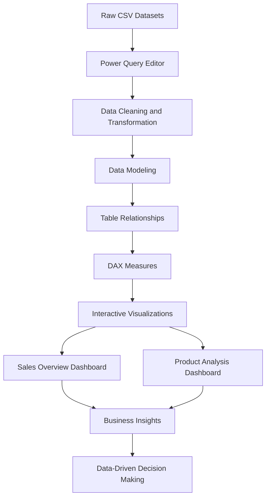

# 🛍️ Myntra Sales & Product Analytics Dashboard


## 📌 Project Overview

The Myntra Sales & Product Analytics Dashboard is an interactive, two-page business intelligence solution developed using Microsoft Power BI.

This project transforms raw e-commerce datasets into meaningful business insights through data cleaning, data modeling, DAX calculations, and interactive visualizations.

The dashboard provides a comprehensive understanding of sales performance, product distribution, inventory management, brand performance, customer purchasing patterns, and order status.

---

## 🎯 Project Objectives

- Analyze overall sales and revenue performance.
- Monitor monthly order and revenue growth.
- Identify top-performing brands and product categories.
- Analyze revenue contribution across different city tiers.
- Evaluate product inventory by size.
- Identify the top 10 revenue-generating products.
- Monitor order status and distribution.
- Enable interactive business decision-making.

---

## 📊 Key Performance Indicators

| Business Metric | Performance |
|---|---:|
| Total Orders | 1,80,000 |
| Total Revenue | ₹118.90 Crore |
| Total Products | 2,500 |
| Orders MoM Growth | -4.8% |
| Revenue MoM Growth | -3.2% |
| Total Dashboard Pages | 2 |
| Data as of | 01-May-2025 |

---

## 📈 Page 1 — Sales Overview


The Sales Overview dashboard provides a high-level view of business performance through interactive KPIs, trend analysis, and sales visualizations.

### Dashboard Features

- Total Orders KPI
- Total Revenue KPI
- Month-over-Month Order Growth
- Month-over-Month Revenue Growth
- Monthly Order Trend
- Monthly Revenue Trend
- Orders by City Tier
- Orders by Product Category
- Orders by Brand
- Interactive Brand Slicer
- Interactive Category Slicer
- Interactive City Tier Slicer
- Page Navigation Buttons
- Dynamic Reporting Date

### Key Sales Insights

- The dataset recorded 180,000 orders, generating approximately ₹118.90 crore in total revenue.
- Tier 2 cities accounted for approximately 49.97% of total orders.
- Tier 1 cities contributed approximately 37.46% of total orders.
- Tier 3 cities contributed approximately 12.57% of total orders.
- Kids Wear emerged as the leading product category with approximately 24,000 orders.
- School Shoes recorded approximately 22,000 orders.
- Nike led brand-wise order performance with approximately 19,600 orders.
- Negative monthly growth in orders and revenue indicates an opportunity for further sales performance investigation.

---

## 📦 Page 2 — Product Analysis


The Product Analysis dashboard focuses on product performance, inventory distribution, brand revenue, geographic revenue contribution, and order status.

### Dashboard Features

- Total Products KPI
- Product Distribution by Category
- Size-wise Inventory Analysis
- Brand-wise Revenue Performance
- City Tier Revenue Analysis
- Top 10 Products by Revenue
- Order Status Distribution
- SKU-Level Product Analysis
- Interactive Page Navigation

### Key Product Insights

- The product catalog contains 2,500 products.
- Medium (M) size has the highest inventory, with approximately 500,000 units.
- Large (L) size accounts for approximately 380,000 inventory units.
- Small (S) size accounts for approximately 370,000 inventory units.
- Nike leads brand revenue performance at approximately ₹13.32 crore.
- Tier 2 cities generate the highest revenue at approximately ₹59.33 crore.
- Tier 1 cities contribute approximately ₹44.64 crore.
- Tier 3 cities contribute approximately ₹14.93 crore.
- The top 10 products collectively generate approximately ₹1.09 crore in revenue.
- Order status distribution highlights opportunities to investigate cancellations, returns, and delivery performance.

---

## 🛠️ Tools & Technologies

| Technology | Purpose |
|---|---|
| Microsoft Power BI | Dashboard Development |
| Power Query | Data Cleaning and Transformation |
| DAX | Business Calculations and KPIs |
| Data Modeling | Table Relationships |
| CSV Files | Data Source |
| Microsoft Power BI Desktop | Report Development |
| GitHub | Project Documentation and Portfolio |

---

## 🗂️ Dataset Structure

The project includes the following source tables:

| Table | Description |
|---|---|
| myntra_orders_master_ | Master Order Transactions |
| myntra_product_catalog | Product and Inventory Details |
| myntra_web_catalog | Online Product Catalog |
| myntra_summer_orders | Summer Season Orders |
| myntra_winter_orders | Winter Season Orders |
| myntra_festive_orders | Festive Season Orders |
| Date_Table | Date Dimension for Time Intelligence |
| Inventory_Size | Calculated Size-wise Inventory Table |

---

## 🧹 Data Cleaning & Transformation

Data preparation was performed using Power Query Editor to improve data consistency and prepare the datasets for analysis.

The workflow included:

- Importing source datasets
- Reviewing data quality
- Standardizing column names
- Configuring appropriate data types
- Preparing cleaned tables
- Organizing date fields
- Preparing numerical and categorical fields
- Preserving Power Query Applied Steps
- Preparing datasets for data modeling

---

## 🔗 Data Modeling

The data model connects order transactions with product and date information to support meaningful business analysis.

### Modeling Components

- Master Orders Table
- Product Catalog
- Date Dimension
- SKU-Based Relationships
- Date-Based Relationships
- Calculated Inventory Table
- Business Measures
- Filter Context Management

The model enables dynamic filtering, product-level analysis, revenue aggregation, and time-based business calculations.

---

## 🧮 DAX Measures & Calculations

The project incorporates DAX measures for calculating business performance indicators.

### Key Calculations

- Total Orders
- Total Revenue
- Average Order Value
- Total Products
- Revenue in Crores
- Previous Month Orders
- Previous Month Revenue
- Orders Month-over-Month Growth
- Revenue Month-over-Month Growth
- Dynamic Reporting Date
- Inventory Units by Size

### Business Calculation Logic

**Month-over-Month Growth**

Growth % = (Current Month Value - Previous Month Value) / Previous Month Value × 100

**Average Order Value**

Average Order Value = Total Revenue / Total Orders

**Revenue in Crores**

Revenue in Crores = Total Revenue / 10,000,000

---

## ⚙️ Project Workflow



---

## 🎨 Dashboard Design & User Experience

The dashboard was designed with a professional and consistent visual identity inspired by Myntra.

### Design Highlights

- Myntra-inspired branding
- Dark navy header and navigation sidebar
- Purple and green KPI indicators
- Consistent chart color palette
- Clean dashboard card layouts
- Interactive slicers
- Custom dashboard icons
- Functional page navigation
- Indian currency formatting
- Dynamic date display
- Revenue-based Top 10 product filtering
- Consistent typography and alignment

---

## 💡 Business Recommendations

### 1. Strengthen Tier 2 Market Strategy

Tier 2 cities contribute the highest share of orders and revenue. Marketing campaigns and product availability can be optimized for this segment.

### 2. Prioritize High-Performing Categories

Kids Wear and School Shoes show strong order volumes. These categories can be prioritized for promotional campaigns and inventory planning.

### 3. Improve Inventory Management

Monitor inventory levels across XS, S, M, L, and XL sizes. Compare stock availability with actual sales demand before making replenishment decisions.

### 4. Investigate Monthly Sales Decline

The negative month-over-month growth in both orders and revenue requires further investigation into pricing, promotions, seasonality, and customer demand.

### 5. Optimize Brand Performance

Analyze high-performing brands such as Nike, Puma, and HRX to identify opportunities for assortment planning and targeted promotions.

### 6. Improve Order Fulfillment

Review cancelled and returned orders to understand potential fulfillment, product quality, and customer experience issues.

---

## 🚀 Skills Demonstrated

- Business Intelligence
- Data Analysis
- Data Cleaning
- Data Transformation
- Power Query
- Data Modeling
- Table Relationships
- DAX Calculations
- Time Intelligence
- KPI Development
- Dashboard Design
- Data Visualization
- E-Commerce Analytics
- Inventory Analysis
- Sales Performance Analysis
- Business Storytelling
- Interactive Report Development

---

## 📁 Repository Structure

```text
📦 MYNTRA-SALES-PRODUCT-ANALYSIS-DASHBOARD
│
├── 📁 ASSETS/
│   ├── 🖼️ SALES_OVERVIEW.png
│   └── 🖼️ PRODUCT ANALYSIS.png
│
├── 📁 DATASETS/
│   └── 📦 MYNTRA_DATASETS.ZIP
│
├── 📊 MYNTRA_SALES_DASHBOARDS.pbix
│
└── 📄 README.md
```

---

## 📥 How to Use This Project

1. Download the Power BI PBIX file from this repository.
2. Install Microsoft Power BI Desktop.
3. Open the downloaded PBIX file.
4. Explore the Sales Overview dashboard.
5. Use the Brand, Category, and City Tier slicers.
6. Navigate to the Product Analysis dashboard.
7. Explore inventory, brand revenue, and Top 10 product performance.

Refreshing the report may require access to the original CSV data sources.

---

## 🏆 Project Outcome

This project demonstrates the practical application of Microsoft Power BI in transforming e-commerce transactional data into interactive and actionable business intelligence.

By combining data preparation, data modeling, DAX calculations, and professional dashboard design, the project provides a comprehensive analytical view of sales, products, inventory, and business performance.

---

## 📢 Disclaimer

This project is developed for educational and data analytics portfolio purposes. It is not an official Myntra business intelligence report or an affiliated commercial project.

All reported insights are based on the dataset used for this analysis.

---

## ⭐ Support

If you found this project useful or interesting, consider giving this repository a star.

**Turning Raw Data into Meaningful Business Insights.**

🚀 Built with Microsoft Power BI | Power Query | DAX | Data Analytics

## Author- Yash Pandey
